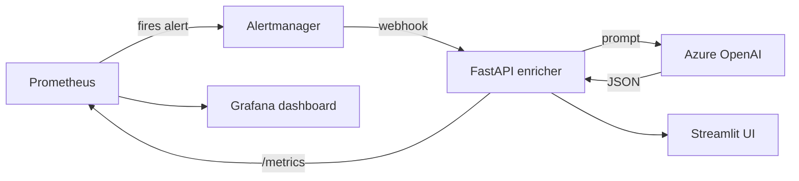

# Alert Enricher

Turns raw Prometheus alerts into plain-English explanations with likely causes and runbook steps, using Azure OpenAI (gpt-4o-mini).

## How it works



1. Prometheus evaluates alert rules and sends firing alerts to Alertmanager.
2. Alertmanager posts them to the enricher webhook.
3. The enricher asks the model for a summary, likely causes, runbook steps and urgency.
4. Results are saved and shown in a Streamlit page. Pipeline health (alerts processed, latency, failures) is shown in Grafana.

## Features

- Alertmanager webhook receiver built with FastAPI
- AI-generated summary, likely causes, runbook steps and urgency
- Alert text treated as untrusted input (length limits, prompt tells the model to ignore instructions inside alerts)
- Safe suggestions only (checks, not destructive actions)
- Own Prometheus metrics and a provisioned Grafana dashboard
- Failures are recorded, not lost

## Quick start

Requirements: Python 3.11+, Docker, an Azure OpenAI endpoint and key.

```bash
cp .env.example .env          # then add your endpoint and key
pip install -r requirements.txt

# terminal 1
uvicorn webhook:app --host 0.0.0.0 --port 8001
# terminal 2
docker compose up -d
# terminal 3
streamlit run ui.py
```

Send a fake alert without any outage:

```bash
python test_alert.py
```

| Service | URL |
|---|---|
| Streamlit UI | http://localhost:8501 |
| Prometheus | http://localhost:9090 |
| Alertmanager | http://localhost:9093 |
| Grafana | http://localhost:3000 (admin / admin, change it) |

## Tests (manual)

| Case | Expected |
|---|---|
| Run `test_alert.py` | Enriched alert appears in the UI |
| `DemoAlwaysFiring` rule | Alert flows through Alertmanager automatically |
| Stop node-exporter | `TargetDown` fires and is enriched |
| Wrong API key | Alert saved with "failed" status, no crash |

## Security notes

- Secrets live in `.env`, which is git-ignored.
- `--host 0.0.0.0` is for local or lab use only. Do not expose the webhook publicly without authentication.
- AI output can be wrong. Verify before acting on it.

## Screenshots

Add screenshots of the UI and Grafana dashboard here.

## Tech stack

Python, FastAPI, Streamlit, Prometheus, Alertmanager, Grafana, Docker Compose, Azure OpenAI.
